<h1 data-importer="text" align="center">Opa como vai?</h1>

  Eu sou o Vinicius, mas pode me chamar de Vini! 🚀 
  Estudante de Ciência de Dados na Fatec Rubens Lara e técnico em Desenvolvimento de Sistemas pela Etec de Itanhaém, direto do litoral sul de São Paulo 🌊 
  Gosto de transformar dados em algo que as pessoas consigam entender e usar. Entre meus projetos estão um sistema de previsão de demanda para restaurante universitário (Python, Streamlit e AWS) e um dashboard com dados públicos de preço de combustíveis. 
  Estou em busca da minha primeira oportunidade como Cientista de Dados júnior, então se curtiu o que viu por aqui, bora trocar uma ideia! 💬

###

  

###

  
  
  
  
  
  
  
  
  
  
  
  
  
  
  
  
  

###

###

<picture data-importer="pacman">
  <source media="(prefers-color-scheme: dark)" srcset="https://raw.githubusercontent.com/ViniciusOliveira0007/ViniciusOliveira0007/pacman-output/pacman-contribution-graph-dark.svg?game=pacman">
  <source media="(prefers-color-scheme: light)" srcset="https://raw.githubusercontent.com/ViniciusOliveira0007/ViniciusOliveira0007/pacman-output/pacman-contribution-graph.svg?game=pacman">
  
</picture>

###

  

