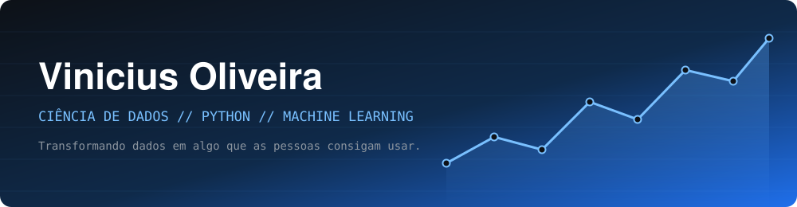
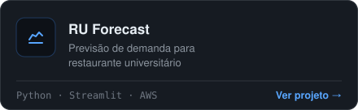
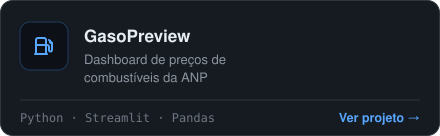
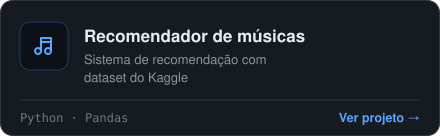
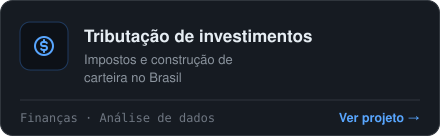

 

  

  

 

CIÊNCIA DE DADOS // MACHINE LEARNING // VISUALIZAÇÃO // PYTHON

 

---

**`IDENTIDADE: ESTUDANTE DE CIÊNCIA DE DADOS`**

**`FOCO: PRIMEIRA VAGA COMO CIENTISTA DE DADOS JÚNIOR`**

Opa, como vai? Eu sou o Vinicius, estudante de Ciência de Dados na **Fatec Rubens Lara** e técnico em Desenvolvimento de Sistemas pela **Etec de Itanhaém**, direto do litoral sul de São Paulo.

Gosto de transformar dados em algo que as pessoas consigam entender e usar. Se curtiu o que viu por aqui, bora trocar uma ideia! 💬

---

**`TECNOLOGIAS`**

 

  
  
  
  
  
  
  
  
  
  

 

---

**`PROJETOS EM DESTAQUE`**

 

  
  

  
  

---

Feito com curiosidade, café e abas demais abertas.

